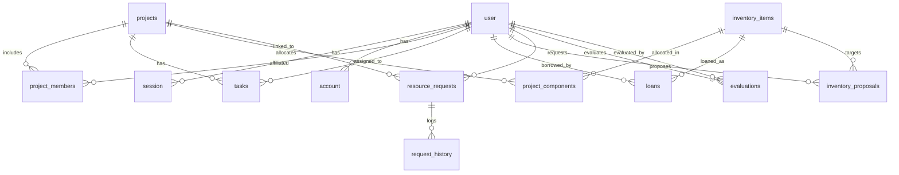

# SPEC.md — Especificação do Sistema RAIapp

## 1. Visão Geral

O **RAIapp** é a plataforma web interna do grupo **RAITec · UFC** (Robótica, Automação e Inovação) para gestão de membros, eixos, projetos, tarefas, inventário de componentes, requisições de recursos e avaliações cruzadas.

### Objetivos Técnicos
- Persistência durável em **PostgreSQL 17** via **Drizzle ORM (`postgres.js`)**, containerizada com **Docker Compose** (serviços `postgres` e `app`).
- Autenticação real com **Better Auth** (e-mail/senha + sessão em banco + cookie assinado HTTP-only).
- Autorização rigorosa baseada em papel, eixo e time (RBAC) aplicada exclusivamente no servidor (`src/lib/access.ts` + `src/lib/api/`).
- Qualidade e padronização garantidas por **Biome**, **TypeScript strict** e **testes automatizados com Bun**.

---

## 2. Estrutura Organizacional e Papéis

### Eixos Oficiais (`Eixo`)
| Slug | Nome |
|---|---|
| `inovacao` | Inovação |
| `tecnico-sustentavel` | Técnico Sustentável |
| `tecnologias-saude` | Tecnologias em Saúde |

### Times Oficiais (`Time`)
| Slug | Nome |
|---|---|
| `processos` | Processos |
| `midias` | Mídias |

### Papéis (`Role`) e Invariantes de Vínculo
As combinações abaixo são garantidas em **TypeScript** (união discriminada `Member`), na **validação Zod/Better Auth** e em **CHECK constraint no PostgreSQL**:

| Papel | `eixo` | `time` | Regra Organizacional |
|---|---|---|---|
| `membro` | Obrigatório | Obrigatório | Pertence a 1 eixo e 1 time |
| `coordenador` | Obrigatório | `null` | **No máximo 1 coordenador por eixo**; sem time |
| `diretoria` | `null` | `null` | Visão global; ao menos 1 diretor ativo no sistema |

---

## 3. Matriz de Permissões (RBAC)

Fonte única da verdade: `src/lib/access.ts`.

| Capacidade | Membro (Mídias) | Membro (Processos) | Coordenador | Diretoria |
|---|---|---|---|---|
| Ver próprio eixo (`/eixos/[eixo]`) | Sim | Sim | Sim | Todos os 3 |
| Gerenciar projetos, tarefas e alocações do eixo | Não | Não | Próprio eixo | Não |
| Atualizar status de tarefa | Só próprias | Só próprias | Qualquer do eixo | Não |
| Usar Painel da Coordenação (`/eixos/[eixo]/painel`) | Não | Não | Próprio eixo | Todos os 3 |
| Criar requisições | Para coordenação do eixo (6 tipos) | Para coordenação do eixo (6 tipos) | Pedido à diretoria (`pedido`) | Não faz |
| Resolver requisições de membros | Não | Não | Próprio eixo | Qualquer eixo |
| Resolver pedidos de coordenadores (`/diretoria`) | Não | Não | Não | Sim |
| Ver inventário completo (`/inventario`) | Sim | Sim | Sim | Sim |
| Criar/editar/excluir item de inventário | Não | Propõe (`InventoryProposal`) | Próprio eixo + sem dono | Qualquer item |
| Aprovar/recusar propostas de inventário | Não | Não | Eixo dono + sem dono | Qualquer proposta |
| Enviar avaliação cruzada (`/avaliacao`) | Qualquer colega (exceto si) | Qualquer colega (exceto si) | Qualquer colega (exceto si) | Qualquer colega (exceto si) |
| Ver relatório detalhado de avaliações de membro | Não | Não | Próprio eixo | Não |
| Gerenciar papéis de membros (`/diretoria/membros`) | Não | Não | Não | Sim |

---

## 4. Módulos Funcionais

### 4.1 Autenticação e Sessão
- **Rotas públicas**: `/login`, `/cadastro`.
- **Cadastro (`/cadastro`)**: exige nome (≥ 3 chars), e-mail único, senha (≥ 8 chars) + confirmação, `eixo` e `time`. Cria conta sempre com `role = "membro"` (`role` bloqueado para input externo).
- **Login (`/login`)**: e-mail + senha via Better Auth (`signInEmail`); erros renderizados inline com `<Alert tone="danger">`.
- **Logout**: ação server-side (`logoutAction`) que revoga a sessão no banco, limpa o cookie e redireciona para `/login`.
- **Proteção de rotas**:
  - `src/proxy.ts` redireciona anônimos (sem cookie de sessão) em rotas protegidas para `/login`.
  - `app/(auth)/layout.tsx` redireciona para `/dashboard` quem acessa `/login` ou `/cadastro` com sessão **válida no banco** (cookie órfão não causa loop).
  - O cadastro também é validado no hook `databaseHooks.user.create.before` do Better Auth (nome ≥ 3, `eixo`/`time` válidos), retornando HTTP 400 mesmo em chamadas diretas a `/api/auth/sign-up/email`.
  - `src/lib/session.ts` valida a sessão real no PostgreSQL em todo request autenticado.
  - Acesso autenticado sem permissão dispara `forbidden()` (HTTP 403 → `app/(app)/forbidden.tsx`, via `experimental.authInterrupts: true`).
- **Modo de desenvolvimento rápido (`DEV_QUICK_SWITCH=true`)**:
  - Disponível **apenas** quando `NODE_ENV !== "production"` **e** `DEV_QUICK_SWITCH === "true"`.
  - Permite selecionar qualquer usuário cadastrado no banco (em `/login` ou no menu do header) criando uma **sessão real do Better Auth** no PostgreSQL.
  - Desligado por padrão (`false`): exige login manual completo.

### 4.2 Dashboard (`/dashboard`)
- Exibe saudação personalizada, pontuação pessoal (`score` / meta), grade de trajetória (`capacitacoes`, `cursos`, `visitas`, `atividades`) e lista de atividades recentes persistidas no PostgreSQL.

### 4.3 Gestão de Eixos (`/eixos/[eixo]`)
- `/eixos` redireciona para o primeiro eixo acessível ao membro.
- Abas: **Visão geral**, **Projetos**, **Membros** e (para coordenação/diretoria) **Painel da Coordenação** com contador de pendências (requisições pendentes + propostas pendentes).
- Diretoria vê seletor de eixos (`EixoTabs`) para alternar entre os 3 eixos.
- **Visão geral**: desempenho do eixo, coordenador atual, contagem de membros, projetos ativos, média de avaliação cruzada do ciclo anterior, pontuação por time e metas do eixo.
- **Membros**: lista membros do eixo ordenados por pontuação (`Em dia` se `score >= 60`, senão `Atenção`). Coordenação do eixo pode abrir `/eixos/[eixo]/membros/[memberId]` para ver avaliações cruzadas detalhadas.

### 4.4 Projetos e Tarefas (`/eixos/[eixo]/projetos`)
- CRUD de projetos restrito à coordenação do eixo.
- Apenas membros do mesmo eixo podem ser afiliados ao projeto.
- Ao remover um membro de um projeto na edição, tarefas atribuídas a ele passam a `assigneeId = null` (em transação).
- Ao excluir um projeto, requisições vinculadas têm `projectId` limpo (`null`) e tarefas/alocações do projeto são removidas em cascata.
- Tarefas só podem ser atribuídas a membros afiliados ao projeto (ou sem responsável).
- Alocação de componentes respeita o estoque disponível em transação (`total - em_uso`).

### 4.5 Inventário e Propostas (`/inventario`)
- Todos visualizam o inventário completo com filtros (categoria, armário, eixo proprietário) e detalhe de uso (`/inventario/[id]`: projetos + empréstimos ativos).
- `inUse = SUM(project_components.quantity) + SUM(loans.quantity WHERE returned_at IS NULL)`; `available = max(0, total - inUse)`.
- Não é permitido reduzir `total` abaixo de `inUse` nem excluir item com `inUse > 0`.
- **Propostas do time Processos**: membros com `role = "membro"` e `time = "processos"` podem propor `criar`, `editar` ou `excluir` itens (`InventoryProposal`). Propostas aparecem no Painel da Coordenação do eixo dono (ou de qualquer eixo se `ownerEixo = null`) e para a diretoria; ao aprovar (`aplicada`), a mutação é executada atomicamente na mesma transação.

### 4.6 Requisições (`/minha-area/requisicoes`, `/eixos/[eixo]/painel`, `/diretoria`)
- **Membros → Coordenação** (`reviewer = "coordenacao"`):
  - `componente`: item do inventário + quantidade. Ao aprovar, valida estoque e aloca no projeto vinculado ou cria empréstimo (`loans`). Avança `em-uso` → `devolvido` (liberando estoque/encerrando empréstimo).
  - `reuniao`: data, horário, sala (`ROOMS`). Bloqueia conflito de sala/data/horário com reunião aprovada/agendada. `agendada` → `realizada` (manual ou automático quando `date < today`).
  - `autorizacao`: início e fim. `ativa` → `revogada` (manual) ou `expirada` (automático quando `endDate < today`).
  - `verba`: valor, finalidade, prazo. `aguardando-liberacao` → `liberada` → `prestacao-entregue`.
  - `compra`: nome, quantidade, prazo, valor estimado. `aguardando` → `feito` exclusivamente via `completePurchase` (cria item no inventário, aloca no projeto ou cria empréstimo e registra `paidValue` em transação).
  - `outros`: explicação + data opcional. `aguardando` → `feito`.
- **Coordenadores → Diretoria** (`reviewer = "diretoria"`):
  - `pedido`: título, explicação e justificativa. `aguardando` → `feito`.
- **Prazos integrados**: compras, verbas, reuniões e outros aprovados em andamento aparecem em **Minha área** (e compras do eixo aparecem também para a coordenação e no projeto vinculado).

### 4.7 Avaliação Cruzada (`/avaliacao`)
- Cada membro avalia qualquer colega (todos os eixos + coordenação + diretoria, exceto a si mesmo) no ciclo atual em 5 critérios (escala 1–5) + comentário opcional.
- Reenvio no mesmo ciclo atualiza a avaliação existente (`UPSERT` na chave `(cycle, evaluator_id, evaluatee_id)`).
- O avaliado vê apenas suas médias agregadas por critério do ciclo anterior; a coordenação do eixo do avaliado vê o detalhamento completo por ciclo.

### 4.8 Diretoria e Gestão de Papéis (`/diretoria`, `/diretoria/membros`)
- Área exclusiva da `diretoria` com abas:
  - **Pedidos das coordenações** (`/diretoria`): fila de requisições com `reviewer = "diretoria"`.
  - **Membros e papéis** (`/diretoria/membros`): lista todos os membros cadastrados e permite alterar `role`, `eixo` e `time` respeitando:
    1. Invariantes de vínculo (`membro`, `coordenador`, `diretoria`).
    2. **Unicidade de coordenação**: no máximo 1 coordenador por eixo (bloqueia se o eixo já possuir outro coordenador).
    3. **Proteção contra auto-bloqueio**: impede rebaixar o último usuário com papel `diretoria`.
    4. **Consistência de eixo**: ao mudar o eixo de um membro (ou promovê-lo à diretoria), remove suas afiliações a projetos do eixo anterior e limpa `assigneeId` das tarefas daqueles projetos em transação.

---

## 5. Modelo de Dados Relacional (PostgreSQL / Drizzle)

Tabelas auxiliares de métricas/painel (populadas via `seed.ts`): `activities`, `eixo_goals`, `eixo_metrics`.

---

## 6. Requisitos Não-Funcionais e Critérios de Aceite

- **Docker**: `docker compose up -d postgres` sobe banco saudável (`healthy`); `docker compose up --build` sobe `postgres` → `migrate` (aplica migrations e encerra) → `app` integrados.
- **Qualidade**: `bun run lint` (Biome), `bun run typecheck` (`bun check`), `bun test` e `bun run build` passam com 0 erros.
- **Persistência**: alterações criadas pela interface (projetos, tarefas, inventário, requisições, avaliações, papéis e novos usuários) sobrevivem ao reinício do servidor e do container.
- **Segurança**: nenhuma rota de `(app)` é acessível sem sessão válida; nenhuma escalação de papel é possível pelo `/cadastro`; mutações financeiras/estoque/papéis são atômicas em transação.

---

## 7. Escopo Futuro (Fora desta Entrega)

- Verificação de e-mail e fluxo "Esqueceu sua senha?" com provedor SMTP / Mailpit.
- Telas de CRUD para atividades do dashboard, metas de eixo e gestão de pontuações/ciclos de avaliação.
- Tela "Meu perfil" (edição de nome/avatar/senha) e central de notificações em tempo real.
